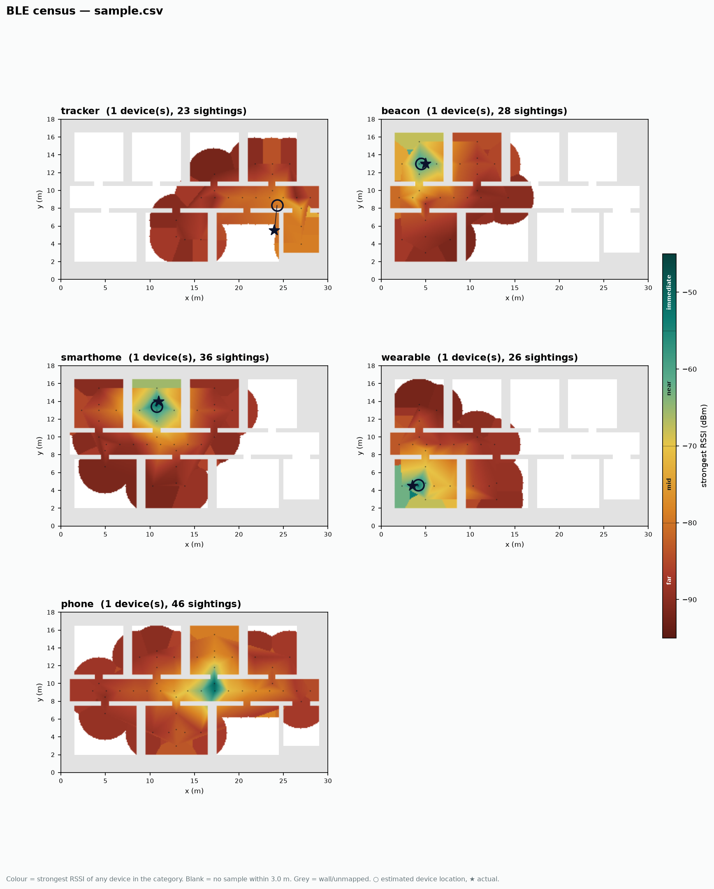

# go2-ble-census

A passive Bluetooth/BLE census on a Unitree Go2. The robot walks a floor it has
already mapped and logs every BLE advertisement and discoverable classic-BT
device it hears, geotagged to the SLAM pose — producing per-category heatmaps
("beacons", "smart-home", "wearables", "trackers") registered to the floorplan.
The classroom artifact is *"here is every radio that announces itself in this
building, and what it gives away."*

Sibling to **[go2-rf-survey](../go2-rf-survey)** — the mobility, SLAM and
pose-join architecture are the same; only the sensor changes. This repo vendors
the parts it needs so it stands alone.

**Status:** the entire off-robot pipeline works and is proven end to end —
decode → geotag → localize → render. Verified two ways: against a **real radio**
(a 6 s workstation scan saw 440 sightings and classified Find My trackers,
AirPods and beacons live) and against **known ground truth** (a synthetic census
localizes persistent devices to ~0.5 m and correctly refuses to locate a
rotating phone). What remains all needs the robot: the ROS node that feeds real
SLAM poses into the already-written pose-join seam.



*Synthetic data with known device positions — ○ estimated location, ★ actual.
It exists so the whole chain is provably correct before the robot produces
anything. The tracker's larger error is honest: it sits in the one room the
route skips, heard only through a wall.*

> ### ▶ Resume here
>
> **Off-robot, no robot needed.** Run the tests, then point an adapter at a room:
>
> ```bash
> python run_tests.py                       # 70 tests, bare Python, no deps
> pip install -r requirements.txt           # bleak, for live capture only
> python -m ble_census.scan --seconds 20 --csv room.csv
> ```
>
> **Next action (phase 02):** read `room.csv`, find the `category=unknown`
> devices that matter in *your* space, and add their vendor IDs / service UUIDs
> to the seed tables in [`ble_scan.py`](ble_census/ble_scan.py). Then the
> on-robot work: pose join (phase 03) and heatmaps (phase 04).
>
> Note: on Windows/macOS `privacy` reads `unknown` — those backends don't
> report address type. BlueZ on the robot's Jetson does, so the
> persistent-vs-rotating headline only comes alive there.

---

## The one thing that reshapes this project: MAC randomization

Modern phones and most new wearables rotate their BLE address every ~15 minutes
(resolvable private addresses). **You cannot track individuals, and the tool is
built not to pretend otherwise.** `address_privacy()` classifies every sighting:

| Class | Meaning | Trackable over time? |
|---|---|---|
| `public` | permanent global identity | **yes** |
| `static-random` | fixed until reboot | **yes** (effectively) |
| `resolvable-random` | rotates ~15 min | no — the privacy feature working |
| `non-resolvable-random` | rotates, no identity | no |

This is not a limitation to work around — **it is the lesson.** The honest
heatmap shows a handful of persistent IoT radios you forgot about, inside a fog
of randomized phones. Showing an audience that their phone is
`resolvable-random` while a $15 sensor on the wall is `public` is the whole
point. Decision, not to be relitigated: **passive scanning only** — receive
advertisements, never send scan-requests or probes. Legally cleaner, and the
extra data an active scan buys is not worth transmitting for a census.

## What it reuses from go2-rf-survey

Same architecture, sensor swapped:

| go2-rf-survey | here |
|---|---|
| `scanner.py` — `iw scan` + **pure parser, 18 tests** | `ble_scan.py` — advertisement decoder, pure, **41 tests** |
| `survey_node.py` — join scan to TF pose at completion, flush rows | same node, BLE scan source *(phase 03)* |
| CSV, one row per AP per position | one row per **device-sighting** per position |
| `heatmap.py` + occupancy + distance masks | unchanged — renders category heatmaps *(phase 04)* |
| D4: stop-and-scan, stamp at completion | same |
| R2: don't scan on your own link | dedicated USB BT; keep the Jetson's onboard radio free |
| **R8: USB 3.0 raises the 2.4 GHz noise floor ~20 dB** | **hits harder — BLE *is* 2.4 GHz.** Same USB-2.0-extension mitigation, now central |

## Output schema

One row per device-sighting per sample position:

| Field | Example | Source |
|---|---|---|
| `stamp` | `1760932481.204` | ROS clock at scan completion |
| `sample_id` | `42` | groups one sweep's rows |
| `x`, `y`, `z` | `14.82, -3.07, 0.40` | TF `map` → `base_link` |
| `yaw` | `1.571` | same transform |
| `addr` | `3c:37:86:a1:b2:c3` | HCI advertising report |
| `addr_type` | `public` / `random` | HCI advertising report |
| `privacy` | `resolvable-random` | derived — trackability class |
| `rssi` | `-71.0` | the measurement |
| `tx_power` | `-59` | advertised, if present — lets you estimate range |
| `name` | `Govee_H5075` | advertisement; often empty |
| `company_id` | `0x004C` | manufacturer data → `Apple` |
| `adv_type` | `ibeacon` / `eddystone` / `findmy` / `mfr` / `plain` | derived |
| `category` | `tracker` | derived — see below |

`category` is conservative on purpose: `unknown` unless there's a defensible
signal. Extend the seed tables in [`ble_scan.py`](ble_census/ble_scan.py) from a
real capture of your own environment rather than padding them with guessed
vendor IDs — a wrong label on a heatmap is worse than "unknown".

## What the decoder understands today

Verified against the Bluetooth SIG Assigned Numbers and pinned by tests:

- **AD-structure walking** — the TLV format, with the same resilience the `iw`
  parser has: a truncated or garbage tail never takes the good leading
  structures down with it.
- **Names, TX power, 16-bit service UUIDs**
- **iBeacon** — Apple `02 15` frame: proximity UUID, major, minor, power → `beacon`
- **Eddystone** — service data `0xFEAA`: UID / URL / TLM frames → `beacon`
- **Find My** — Apple type `0x12` (a *separated* AirTag) → `tracker`
- **Apple proximity pairing** — type `0x07` (AirPods) → `wearable`
- **Tile** — service `0xFEED` → `tracker`
- **Heart Rate / Garmin** → `wearable`
- **Address privacy** — public / static / resolvable / non-resolvable

```bash
python run_tests.py
# Ran 91 tests ... OK
```

## Live capture (off-robot)

`python -m ble_census.scan` is the phase-01/02 bring-up tool: point a real
adapter at a room, watch devices resolve into categories, dump a CSV. It uses
[`bleak`](https://github.com/hbldh/bleak) (BlueZ, Windows, macOS), which hands
the advertisement over already parsed — so each report goes through
`advertisement_from_parsed()`, the **same** classifier the raw-sniffer path
uses. The two capture paths can never disagree on a category; a test suite pins
that.

```bash
pip install -r requirements.txt
python -m ble_census.scan --seconds 20            # live table, strongest first
python -m ble_census.scan --seconds 60 --csv room.csv
```

On the robot, capture switches to a passive nRF52840 sniffer feeding
`decode_advertisement()` raw bytes directly (phase 03) — this CLI is its
off-robot cousin for building the lookup tables.

## Post-processing (off-robot)

The render chain is proven on synthetic data with known ground truth before the
robot exists — the same discipline go2-rf-survey uses. `occupancy.py` is
vendored from that repo; the generator and renderer are BLE-specific.

```bash
pip install -r tools/requirements.txt
python tools/make_synthetic_census.py --out docs/sample
python tools/heatmap.py docs/sample.csv --map docs/sample.yaml \
    --truth docs/sample-truth.csv --out docs/
```

`heatmap.py` draws one coverage panel per category (strongest RSSI of any device
in it, heard at each position), masked by walls and by distance from a real
sample, and overlays each persistent device's **estimated** location
(`ble_census.locate`) against its **actual** position when a truth file is given
— printing the localization error. On the sample that's ~0.5 m for well-sampled
devices; the rotating phone is deliberately never located.

## Localization and the pose-join seam

Two pure modules carry the on-robot logic so it is testable before the robot:

- **[`posejoin.py`](ble_census/posejoin.py)** — a pose buffer that pairs a
  sighting's timestamp to the robot pose then, interpolating between bracketing
  TF poses (yaw on the shortest arc) and **discarding** a sighting across a TF
  gap rather than placing it at a guess (go2-rf-survey's D4/R4). The phase-03
  ROS node is a thin shell over this.
- **[`locate.py`](ble_census/locate.py)** — the "find the hidden tracker"
  estimate: an RSSI-weighted centroid of a device's sightings. Only for
  persistent addresses — it refuses rotating ones, because averaging across a
  phone's ever-changing address is meaningless.

## Build sequence

Ordered by dependency. The deliverable (a category heatmap of a real floor)
lands at phase 04, reusing go2-rf-survey's renderer.

- [x] **00 · Decoder, off-robot** — `ble_scan.py` + fixtures, pure and tested.
      *Exit: `python run_tests.py` green with zero dependencies.* ✅
- [x] **01 · Live capture on a workstation** — `bleak` → the shared classifier,
      live table + CSV. *Exit: `python -m ble_census.scan` lists real devices
      with RSSI and category.* ✅ *(440 sightings on a 6 s real scan)*
- [ ] **02 · Extend the tables** — add the vendor IDs and service UUIDs your
      own environment actually emits. *Exit: your known AirTag / sensor /
      wearable classify correctly from a captured log.* ← **next**
- [ ] **03 · Node integration** — the pure half is done: `posejoin.py` (pose
      buffer + stale-discard) and `writer.py` (takes the pose dict). Remaining
      is the ROS shell that feeds TF poses in. *Exit: CSV rows carry a real
      SLAM pose.*
- [x] **04 · Category heatmaps** ← **deliverable** — `heatmap.py` renders per
      category with located-device overlays. *Exit: proven on synthetic data
      with ground truth; swap in a real CSV + map on the robot.* ✅ *(synthetic)*
- [x] **05 · Localization + classroom numbers** — `locate.py` finds persistent
      devices (~0.5 m on the fixture); `Aggregator` gives the
      persistent-vs-rotating fraction and category counts. ✅ Remaining: wire
      these into a live "your devices light up" view on the robot.

## Hardware delta from the survey rig

Smaller than the WiFi one — and the driver trap is *inverted*.

| Item | Note |
|---|---|
| **USB Bluetooth adapter** | Unlike the MT7612U saga, `btusb` is ancient and in-tree, so kernel 5.10 is a non-issue for almost any adapter. A cheap BLE-5 CSR/Broadcom dongle on BlueZ is enough. |
| **nRF52840 dongle** *(better)* | ~$10, runs Nordic's nRF Sniffer, hops all three advertising channels — captures passively far more completely than BlueZ's single channel. Use this for the "we caught *everything*" demo. |
| **USB 2.0 extension** | Reuse go2-rf-survey's R8 fix. BLE sits at 2.4 GHz inches from the D435i's USB 3.0 noise, so this matters *more* here, not less. |

No new mount, no extra battery beyond what the survey already needs.

## Why this beats the WiFi map in a classroom

- **Visceral** — attendees watch *their own* earbuds and watch appear on the map.
- **Privacy both ways** — IoT exposure *and* the randomization defense; you can
  show which of someone's devices are trackable and which aren't.
- **Tracker detection** — timely, concrete, sympathetic (the stalking angle).
- **Honest about limits** — the randomized-phone fog proves the mitigation
  works. A rare "the defense actually helps" moment in security awareness.

## Ethics & scope

Passive receive-only, on premises you control or are authorized to survey.
Catalog the radios that *broadcast unsolicited*; don't deanonymize people. The
tool deliberately surfaces trackability as a privacy signal, not a targeting
one.

## Layout

```
ble_census/
  ble_scan.py          ✅ advertisement decoder — pure (raw + parsed paths)
  census.py            ✅ live-view aggregation — pure
  writer.py            ✅ CSV schema, one row per sighting — pure
  posejoin.py          ✅ pose buffer + stale-discard geotag seam — pure
  locate.py            ✅ RSSI-weighted device localization — pure
  scan.py              ✅ `python -m ble_census.scan` live capture (bleak)
tools/                    post-processing, runs off-robot (numpy/scipy/mpl)
  occupancy.py            map_server PGM/YAML I/O (vendored from go2-rf-survey)
  make_synthetic_census.py  floorplan + census + ground truth
  heatmap.py              per-category coverage + localization overlay
tests/                 ✅ 91 tests incl. malformed packets, both decode paths,
                          pose interpolation/stale-discard, localization
run_tests.py           ✅ all suites, no dependencies
requirements.txt          bleak — live capture only
docs/                     sample.{pgm,yaml,csv}, sample-truth.csv, the render
README.md
```
